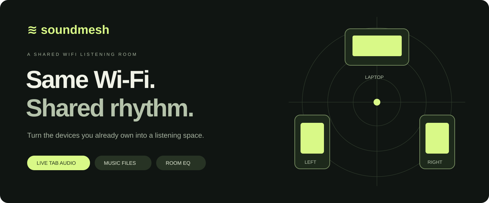
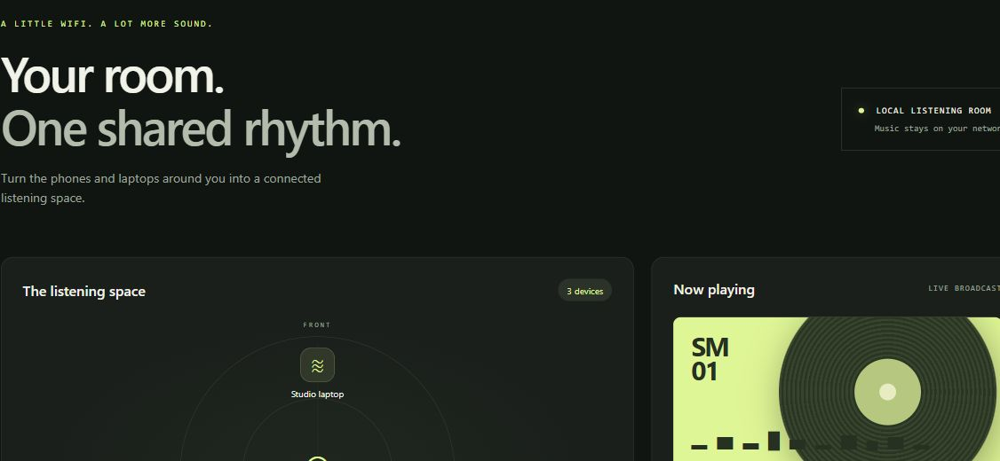
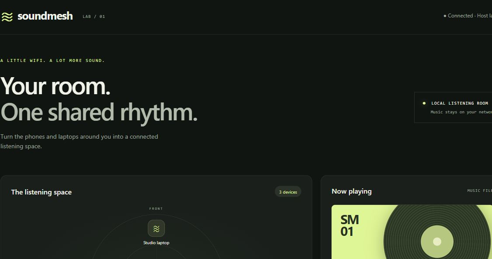
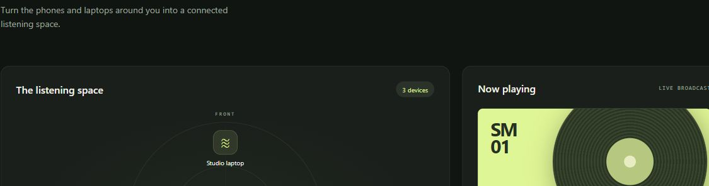
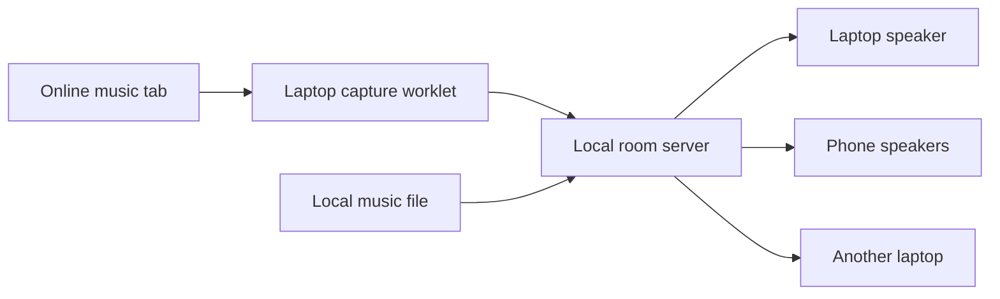

<p align="center"></p>

[](https://github.com/akshit4u9511/soundmesh/actions/workflows/test.yml) [](https://github.com/akshit4u9511/soundmesh/releases/latest) [](LICENSE)

**Turn the phones and laptops you already own into a shared Wi-Fi listening room.**

Broadcast music from a laptop browser tab or a local audio file to devices on the same network. Join with a QR code, enable each speaker, and shape the sound with volume, stereo channel assignments, timing adjustments, and an equalizer.

No accounts. No cloud audio relay. No microphone access.

**[Download for Windows x64](https://github.com/akshit4u9511/soundmesh/releases/latest)** · [Architecture](docs/ARCHITECTURE.md) · [Troubleshooting](docs/TROUBLESHOOTING.md)

## See it in action



| Choose your source | Shape each speaker |
| --- | --- |
|  |  |

*Screenshots use demonstration device names and invitation links, not real session invitations.*

## Features

- **Live tab audio:** share an online music tab from desktop Chrome or Edge.
- **Music files:** downloaded MP3, WAV, and other browser-supported audio, plus a built-in stereo test.
- **Scan to join:** locally generated QR invitations and selectable host network addresses.
- **Shared timing:** clock-offset estimation, scheduled playback, and gentle drift correction.
- **Stereo roles:** full stereo, left channel, or right channel per speaker.
- **Speaker controls:** naming, volume, mute, and −500 to +500 ms timing adjustment.
- **Three-band EQ:** bass, mid, treble; Flat, Warm, Bass boost, Clear vocals, Bright, and Night presets.
- **Room EQ:** apply settings to current speakers and use them as the default for new joins.
- **Continuous laptop audio:** an AudioWorklet player with persistent resampling across packets.
- **Live buffer profiles:** Fast (350 ms), Balanced (700 ms), Stable Wi-Fi (1,400 ms), plus capture/output latency.
- **Double-click launcher:** automatic host-link opening, duplicate-server prevention, and a Stop launcher.
- **Portable Windows x64 ZIP:** bundled runtime, licenses, and SHA-256 checksums.

## Quick start

### Download and double-click

1. Download **SoundMesh-Windows-x64.zip** from the [latest release](https://github.com/akshit4u9511/soundmesh/releases/latest).
2. **Extract the entire folder.** Do not run from inside the ZIP.
3. Double-click **Run SoundMesh.cmd**. Chrome opens with the correct host invitation; Edge is the fallback.
4. Put your other devices on the **same Wi-Fi**. Scan the QR under **Bring another device** or open its join link.
5. Tap **Enable this speaker** on every receiver. Keep the pages open and screens awake.

Double-click **Stop SoundMesh.cmd** when finished. Closing the browser does not stop the background room. Running again reuses the server for that folder. No Node installation or npm command is needed for the portable ZIP.

If Windows requests network access, allow the bundled runtime on your trusted **Private** network. Keep only one enabled SoundMesh page per physical output.

### Live audio

Start music in another tab in the same desktop Chrome or Edge browser. Choose **Live audio → Share live audio**, select the music tab, and enable **Share tab audio** in the picker. Audio starts after the shared buffer fills.

Video remains local; only audio is relayed. Choose a browser tab rather than the entire screen. The browser is asked to suppress the original tab’s immediate local playback, but support varies.

**Pause together** silences room playback without pausing the original service. Resume rejoins current live content after buffering. **Stop broadcasting** ends sharing.

### Downloaded music

Choose **Music file → Choose music file**. Once every unmuted speaker is enabled and has loaded the track, click **Play together**. Files are limited to 80 MB; short tracks use less receiver memory. Uploading a file replaces a live broadcast.

### Equalizer

Scroll to **Shape your sound**. Choose this speaker, a named device, or **All speakers + new joins**. Adjust bass (200 Hz), mid (1 kHz), and treble (4 kHz), or select a preset. Changes apply during playback. Only the host can adjust other speakers or the entire room.

Positive boosts reserve headroom before the filters, so total loudness may decrease. The compressor remains after EQ. Bypass keeps your band settings; Reset to flat clears them.

## Run from source

Requires **Node.js 20 or newer**. No runtime npm packages are needed to start the server.

```sh
git clone https://github.com/akshit4u9511/soundmesh.git
cd soundmesh
npm start
```

Open the **full host URL printed in the terminal**, including `?host=…`. Other devices need the Wi-Fi join URL; `localhost` on a phone refers to that phone.

For development:

```sh
npm ci
npm run check
npm test
```

The source Windows launcher also works with an installed compatible Node.js runtime. The release ZIP supplies its own runtime.

## How it works



The server coordinates a shared clock, room settings, file transfers, and timestamped PCM packets. Secure localhost receivers use continuous AudioWorklet playback; other receivers use the compatible scheduled-buffer player. EQ, gain control, and compression are applied locally before output.

[Read the architecture guide](docs/ARCHITECTURE.md).

## Compatibility and limits

| Capability | Current support |
| --- | --- |
| Portable launcher | Windows x64; Chrome preferred, Edge fallback |
| Source server | Node.js 20+ |
| Live broadcaster | Host laptop in desktop Chrome/Edge, through localhost |
| Receivers | Modern Web Audio browsers; visible page and awake screen |
| iPhone capturing arbitrary app audio | Not implemented |
| AUX / USB speakers | Use the participating laptop’s selected output |
| Bluetooth speakers | Additional latency; alignment not guaranteed |
| Standalone Wi-Fi speakers | Need a compatible receiver or attached participant |
| Spatial audio | Stereo roles; no Atmos, object audio, or head tracking |

SoundMesh is experimental, not a certified surround system. Acoustic alignment depends on hardware latency, Wi-Fi, browser scheduling, and room acoustics. Shared buffering delays audio relative to the original video, so it is intended for music rather than lip-synced viewing or gaming. Some services restrict protected-content capture; SoundMesh does not bypass those restrictions.

If audio sounds harsh, stop playback and test at low volume. See [troubleshooting](docs/TROUBLESHOOTING.md).

## Privacy and security

- Use a trusted local network; local HTTP is unencrypted.
- Join invitations grant listening access; the separate host invitation grants administration access.
- Audio is kept in memory, not saved as a recording.
- QR generation stays on the device. The app has no telemetry or external font service.
- `.soundmesh/` contains private current invitations and logs. It is excluded from Git and release packaging.

Read [SECURITY.md](SECURITY.md). Never post a current host link or a real QR invitation in an issue.

## Development

Tests cover timing, access controls, file transfers, live delivery, stereo waveforms at 44.1/48 kHz, QR decoding, blocked browser storage, and EQ routing/headroom. The Windows smoke test extracts the ZIP, starts without Node on PATH, checks host access and assets, prevents duplicate startup, and shuts down.

[Contributing](CONTRIBUTING.md) · [Building a release](docs/RELEASING.md) · [Changelog](CHANGELOG.md)

## Roadmap

- Assisted acoustic calibration and audio-health diagnostics.
- Separate administrator and broadcaster roles.
- Native receiver and phone-capture experiments.
- Additional spatial rendering after reliable calibration.

## License

[MIT](LICENSE). Node.js and the QR generator retain their own notices; see [third-party licenses](THIRD_PARTY_NOTICES.md).
